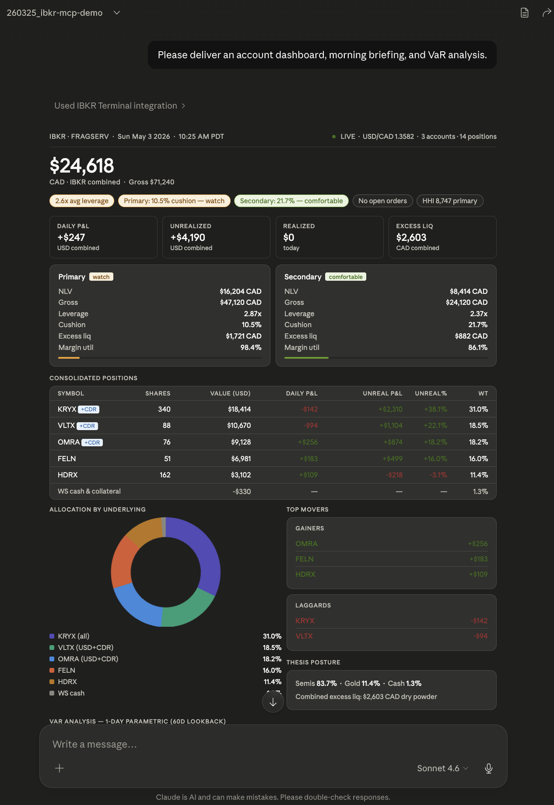

# ibkr-mcp

Read-only MCP server exposing 43 Interactive Brokers portfolio, margin, risk and market-data tools. Published as a teardown of the server layer.



`core/` and `tools/` (the tool implementations) are not in this repository. The code here imports them and does not run standalone.

## Install

Python 3.11+.

```
pip install -r requirements.txt
cp env.example .env
```

Requires a running IB Gateway or TWS with the API enabled.

## Usage

```
python server_http.py      # streamable HTTP, endpoint /mcp/
python server.py           # stdio, deprecated
```

- `server_http.py` runs the reconnect loop (30 s), periodic snapshots and the offline cache. `server.py` has none of these.
- Both share the FastMCP instance in `app.py`. `server_http.py` replaces `app.mcp` with an HTTP-configured, stateless instance before importing the tool modules.
- `dashboard.py` registers `/api/*` REST routes on the same app and port. It must be imported after `server_http.py` has swapped `app.mcp` and registered the tools.
- OAuth 2.1 on `/mcp` is off by default. Enable with `IBKR_MCP_OAUTH_ENABLED=1` and `IBKR_MCP_OAUTH_ISSUER_URL=<public https base of /mcp>`. Scopes are read/propose.
- `ibkr_briefing` takes `compact` and `since_last`. `since_last` compares against the last full briefing and does not advance that baseline. `ibkr_briefing`, `ibkr_margin`, `ibkr_get_positions` and `ibkr_get_account_summary` take `format="terse"`.

## Configuration

Environment variables, loaded from `.env`. Names, defaults and comments are in `env.example`; code defaults are in `config.py`, `server_http.py` and `dashboard.py`.

`thesis_config.json` holds the pillars read by `ibkr_thesis_check`. `risk_factors.json` holds risk factors.

## Tools

All read-only; no order placement.

- Account: `ibkr_get_account_summary` `ibkr_margin` `ibkr_list_accounts` `ibkr_get_account_pnl` `ibkr_consolidated_view`
- Briefing: `ibkr_briefing` `ibkr_geopolitical_risk` `ibkr_thesis_check`
- Portfolio: `ibkr_get_positions`
- Market data: `ibkr_quote` `ibkr_get_historical_bars` `ibkr_get_contract_details` `ibkr_get_option_chain` `ibkr_dividends` `ibkr_search_contracts`
- Live data: `ibkr_get_fx_rate` `ibkr_get_intraday` `ibkr_compare_performance` `ibkr_technicals`
- Risk: `ibkr_what_if` `ibkr_margin_ladder` `ibkr_break_levels` `ibkr_correlation_matrix` `ibkr_portfolio_beta` `ibkr_stress_test` `ibkr_var_estimate`
- Intelligence: `ibkr_sector_exposure` `ibkr_currency` `ibkr_position_detail` `ibkr_rebalance_planner`
- Monitoring: `ibkr_drawdown_tracker` `ibkr_margin_history` `ibkr_cushion_runway` `ibkr_connection_status` `ibkr_selftest`
- Orders (read): `ibkr_trades` `ibkr_get_orders`
- News: `ibkr_news`; Fundamentals: `ibkr_fundamentals`; Scanner: `ibkr_scanner`; Shortable: `ibkr_shortable`; Volatility: `ibkr_volatility`

## Notes

- `IB_READONLY` defaults to true. IB rejects `whatIfOrder` on read-only connections, so `ibkr_what_if`, stress preflight and the cushion trim probe fail until it is set to false.
- `IB_CLIENT_ID` (and `IB_CLIENT_ID_2`) must be unique per connection; do not use 0.
- With `MCP_HTTP_TOKEN` unset, HTTP auth is off. A non-loopback `MCP_HTTP_HOST` refuses to start without it. OAuth covers `/mcp` only; `/api/*` still needs the token.
- Stateless HTTP is required: clients that cache session IDs or overlap SSE streams break otherwise. State lives in the gateway.
- Set `IB_PORT_2` to enable a second gateway; 0 means single-gateway mode.

## Stack

`mcp` (FastMCP), `ib_insync`, `pydantic`, `uvicorn`, `httpx`, `yfinance` (dashboard price fallback), SQLite for NLV history.

## License

Proprietary. See [LICENSE](LICENSE).
